

    

        
    

        <h1>Flujo de finanzas</h1>
        <h3>La app administra bancos, movimientos de dinero, documentos contables y saldos de clientes y proveedores por empresa.</h3>

  

    <a href="#Bancos">Bancos</a> ·
    <a href="#CuentasBancarias">Cuentas Bancarias</a> ·
    <a href="#Conciliaciones">Conciliaciones</a> ·
    <a href="#PolizasContables">Polizas Contables</a> ·
    <a href="#NotasCredito">Notas de credito</a> ·
    <a href="#FacturasProveedor">Facturas de proveedor</a> ·
    <a href="#ProcesoFacturacion">Proceso de facturacion</a> ·
    <a href="#Cxcp">Cuentas por cobrar y cuentas por pagar</a> ·
    <a href="#ProcesoPagos">Proceso completo de pagos</a> ·
  

## 1. Bancos

**Tablas:** `empresas`, `bancos`, `cuentas_bancarias`.

Registrar la institución bancaria con nombre, código, SWIFT y observaciones. Después puede consultarse, actualizarse o desactivarse. El banco sirve para asociar cuentas bancarias; su registro no modifica saldos. No puede eliminarse si tiene cuentas relacionadas.

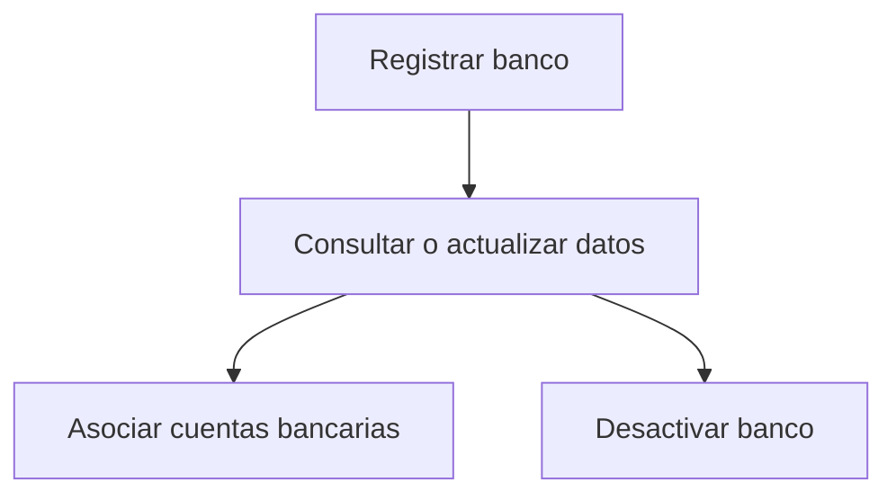

**Relaciones de tablas del flujo:**

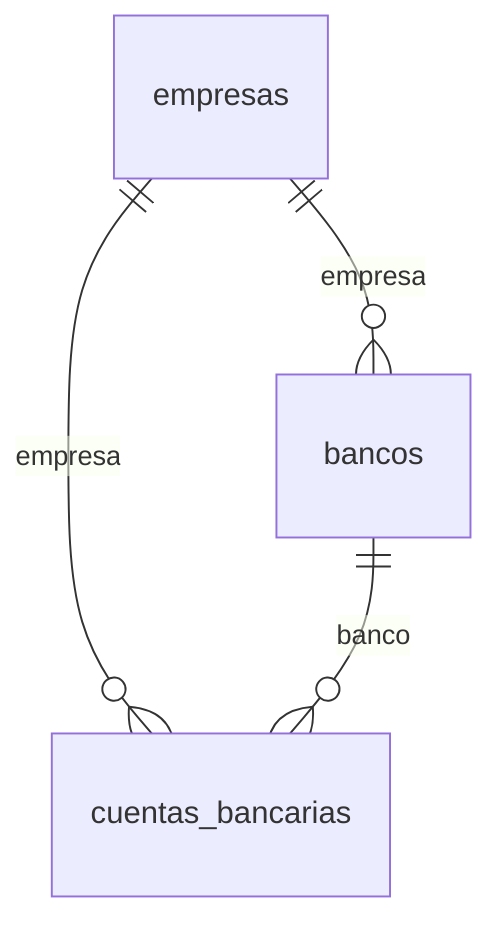

## 2. Cuentas bancarias

**Tablas:** `empresas`, `bancos`, `monedas`, `cuentas_bancarias`, `movimientos_bancarios`, `pagos`, `cobros`.

Seleccionar banco y moneda, capturar alias, titular, número de cuenta, CLABE y saldo de partida. La cuenta se utiliza para registrar cobros, pagos y movimientos adicionales.

Los abonos aumentan el saldo y los cargos lo disminuyen. Se puede consultar el saldo actual y los movimientos recientes. Para corregir un movimiento manual, cancelarlo y registrar el correcto; los movimientos de pagos o cobros se cancelan desde su documento de origen.

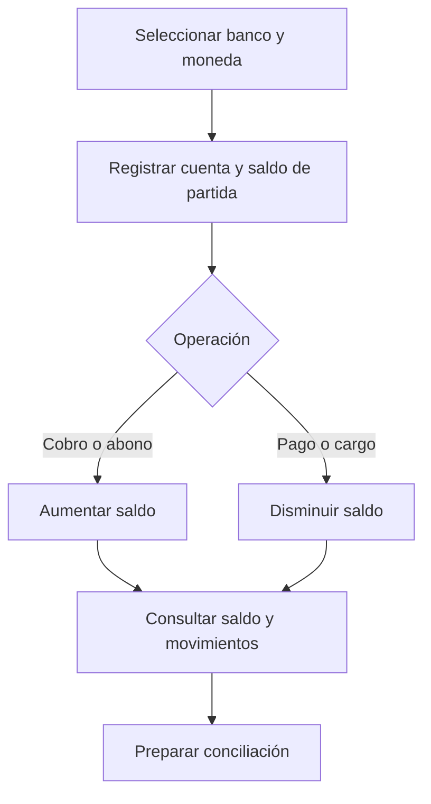

**Relaciones de tablas del flujo:**

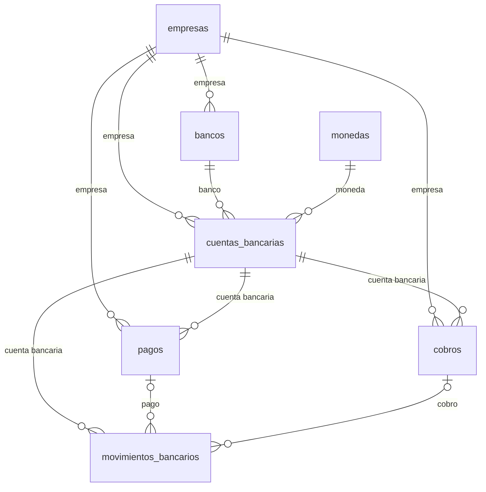

## 3. Conciliaciones

**Tablas:** `cuentas_bancarias`, `movimientos_bancarios`, `conciliaciones_bancarias`, `conciliacion_detalle`, `pagos`, `cobros`.

1. Seleccionar cuenta, período y saldo del estado de cuenta bancario.
2. Preparar la conciliación: se reúnen los movimientos no cancelados del período, se calcula el saldo interno al cierre y se muestra la diferencia frente al banco.
3. Revisar las diferencias y corregir las operaciones que corresponda. Preparar nuevamente actualiza el borrador del mismo período.
4. Cerrar cuando los saldos coincidan, con una tolerancia de un centavo. La conciliación queda **Cerrada** y sus movimientos **Conciliados**.

El cierre no modifica el saldo bancario. Cancelar la conciliación cambia su estado a **Cancelada**, sin revertir saldos ni desmarcar sus movimientos.

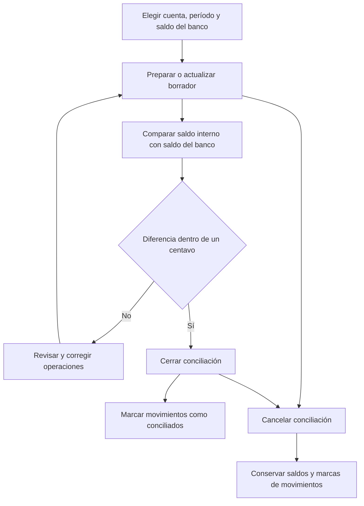

**Relaciones de tablas del flujo:**

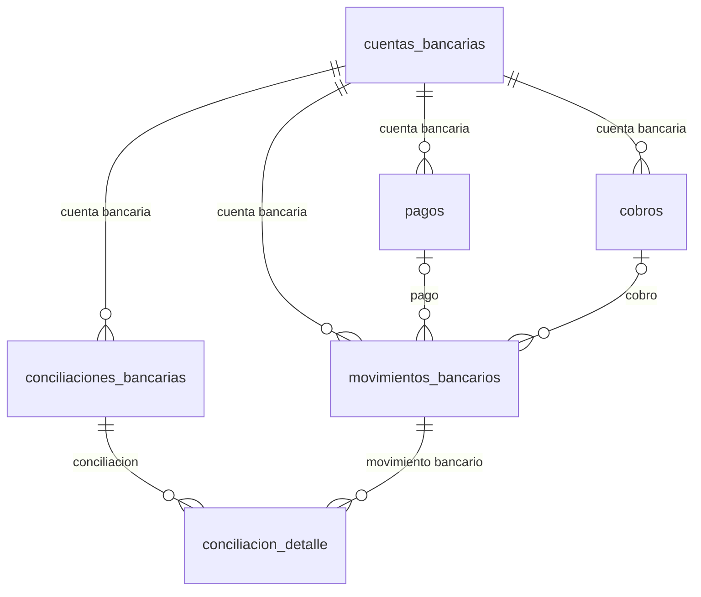

## 4. Pólizas contables

**Tablas:** `empresas`, `sucursales`, `usuarios`, `polizas`, `poliza_detalle`, `cuentas_contables`, `centros_costo`, `facturas`, `facturas_proveedor`, `pagos`, `cobros`, `movimientos_bancarios`.

Registrar una póliza de **Diario**, **Ingreso**, **Egreso** o **Ajuste**, indicando sucursal, concepto y partidas con sus cuentas contables, cargos y abonos. Las partidas pueden vincularse a facturas, pagos, cobros o movimientos bancarios.

La póliza inicia en **Borrador**. Validar que los cargos y abonos coincidan y contabilizarla para dejarla **Contabilizada**. Puede cancelarse; una póliza cancelada no puede contabilizarse y una contabilizada debe cancelarse antes de eliminarse.

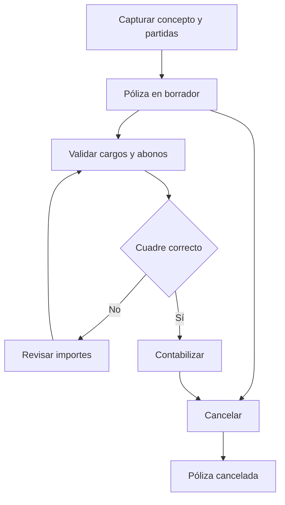

**Relaciones de tablas del flujo:**

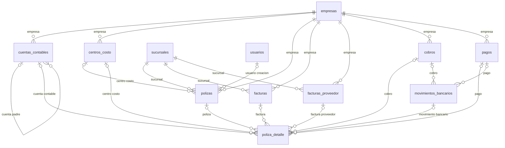

## 5. Notas de crédito

**Tablas:** `clientes`, `facturas`, `factura_detalle`, `notas_creditos`, `nota_credito_detalle`, `cuentas_por_cobrar`.

Seleccionar la factura y su cliente, capturar motivo, importes y partidas relacionadas. La nota puede guardarse en **Borrador** y después pasar a **Emitida**, o registrarse directamente emitida.

Al emitirse, reduce el saldo de la CxC de la factura. Debe existir esa cuenta y el crédito no puede superar su saldo. La cuenta queda **Parcial** o **Pagada** según el saldo restante. Cancelar una nota emitida devuelve el importe acreditado; una nota cancelada no puede editarse y una emitida debe cancelarse antes de eliminarse.

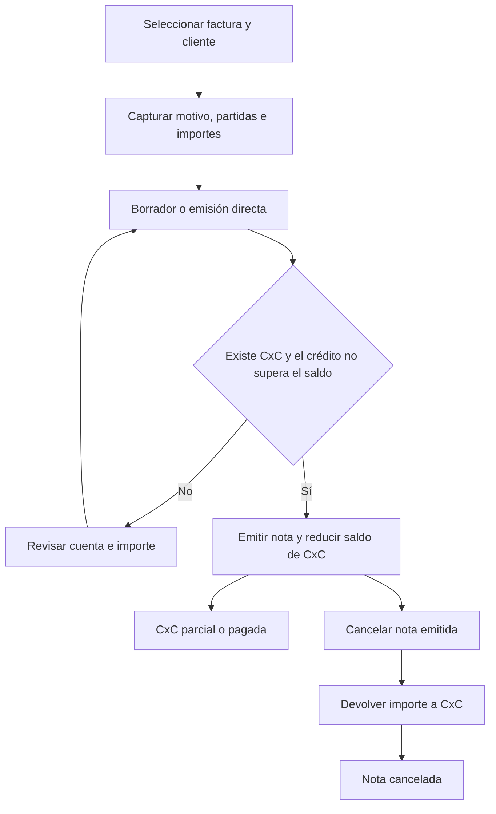

**Relaciones de tablas del flujo:**

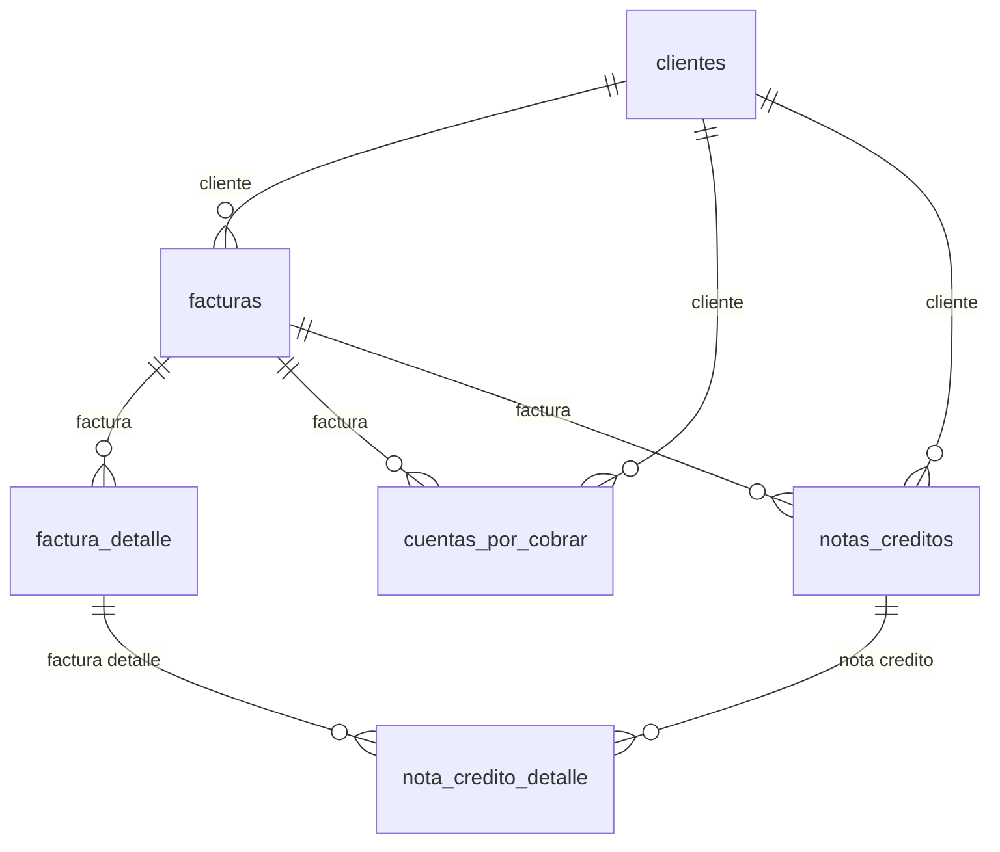

## 6. Pagos

**Tablas:** `empresas`, `proveedores`, `cuentas_bancarias`, `pagos`, `pago_detalle`, `cuentas_por_pagar`, `facturas_proveedor`, `movimientos_bancarios`.

Registrar proveedor, cuenta bancaria, fecha, método, referencia y los importes destinados a las CxP. Puede guardarse en **Borrador** o directamente **Aplicado**.

Al aplicar, debe haber al menos una obligación, cada importe debe ser positivo y no superar su saldo, y las aplicaciones deben coincidir con el total del pago. Las facturas de proveedor deben estar **Registradas**. El pago reduce las CxP, disminuye el saldo bancario y genera un cargo pendiente de conciliación.

Cancelar devuelve los importes a las CxP, restituye el saldo bancario y cancela el movimiento asociado.

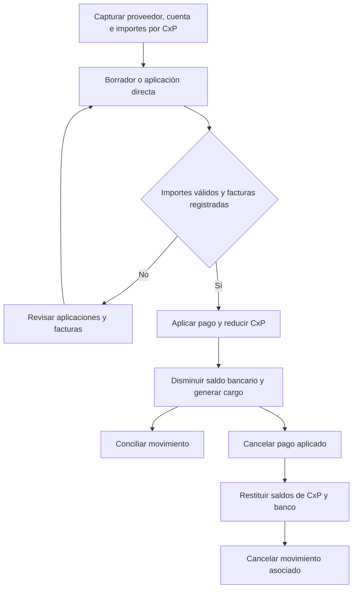

**Relaciones de tablas del flujo:**

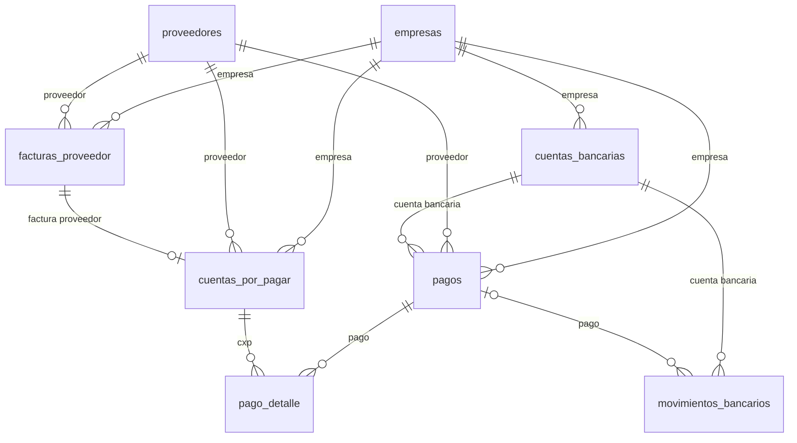

## 7. Facturas de proveedor

**Tablas:** `empresas`, `sucursales`, `proveedores`, `monedas`, `ordenes_compra`, `orden_compra_detalle`, `recepciones`, `recepcion_detalle`, `productos`, `facturas_proveedor`, `factura_proveedor_detalle`, `cuentas_por_pagar`.

Capturar proveedor, sucursal, orden de compra, recepción, moneda, folio, vencimiento e importes. Las partidas corresponden a los productos de la orden y la recepción. Se puede adjuntar la factura en PDF y obtener un documento que la reúne con la orden de compra y la recepción.

Al pasar de **Borrador** a **Registrada**, se genera una CxP pendiente por el total. Mientras exista una CxP vigente, se restringen cambios de total, proveedor y moneda, así como el regreso a borrador o la cancelación. Una factura cancelada no puede modificarse ni reactivarse.

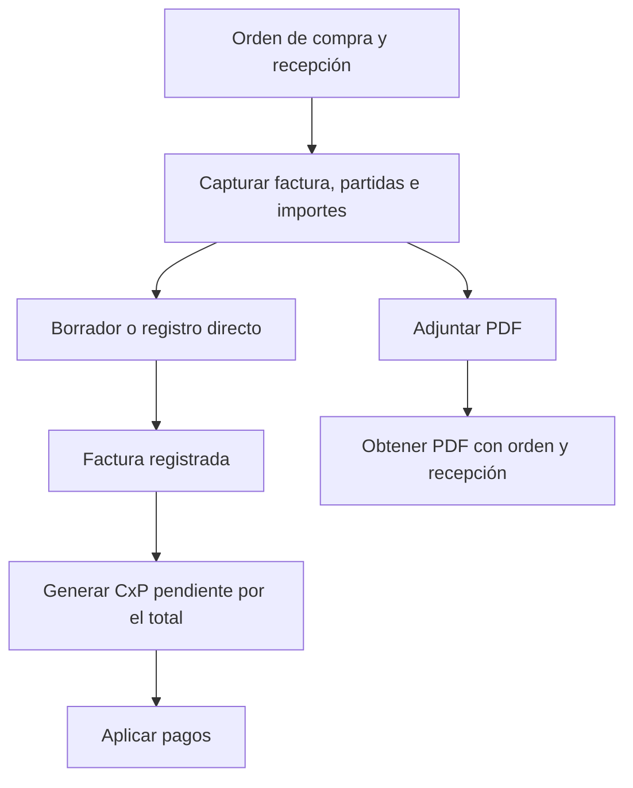

**Relaciones de tablas del flujo:**

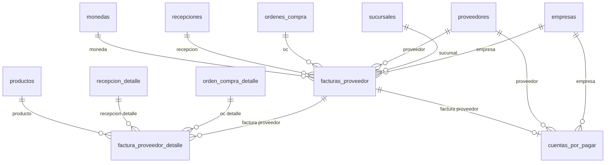

## 8. Proceso de facturación

**Tablas:** `empresas`, `sucursales`, `clientes`, `monedas`, `pedidos`, `pedido_detalle`, `productos`, `series_folios`, `facturas`, `factura_detalle`, `cuentas_por_cobrar`, `polizas`, `poliza_detalle`, `cuentas_contables`, `centros_costo`.

- **Desde un pedido:** crear una factura en borrador con cliente, moneda, productos, cantidades y precios del pedido. Se asigna folio y se calculan totales; esta ruta calcula descuentos e impuestos en cero. No admite otra factura activa no cancelada para el mismo pedido.
- **Pendiente de cobro:** capturar cliente, moneda, folio, vencimiento e importes, con pedido opcional. Se genera una factura **Emitida**, una CxC **Pendiente** por el total y una póliza de ingreso en **Borrador**. Requiere cuentas contables y un centro de costo activo.
- **Comprobante fiscal:** el proyecto permite emitir CFDI mediante Facturama y obtener el PDF, XML y acuse correspondiente. El registro de la factura y su saldo pendiente se realiza mediante el flujo anterior.

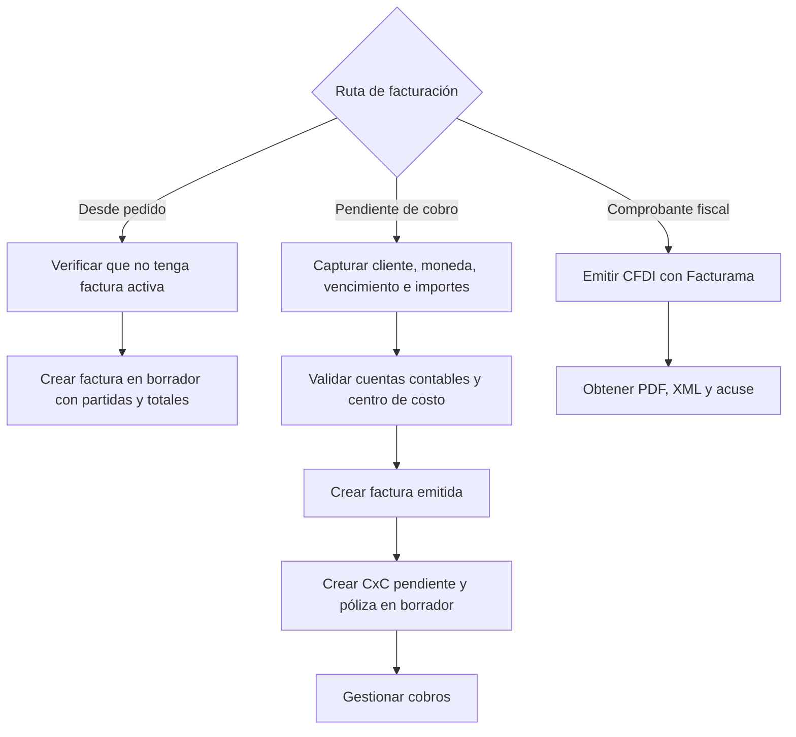

**Relaciones de tablas del flujo:**

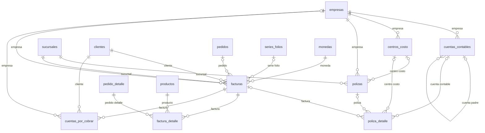

## 9. Cuentas por pagar y cuentas por cobrar (CxP y CxC)

**Tablas:** `empresas`, `clientes`, `proveedores`, `facturas`, `facturas_proveedor`, `cuentas_por_cobrar`, `cuentas_por_pagar`, `cuentas_bancarias`, `cobros`, `cobro_detalle`, `pagos`, `pago_detalle`, `movimientos_bancarios`, `notas_creditos`, `alertas_mora`.

**CxP:** nace al registrar la factura de proveedor, con saldo inicial igual al total y su vencimiento. Existe una sola cuenta por factura. Los pagos reducen el saldo y la dejan **Parcial** o **Pagada**. Con pagos aplicados, se bloquean cambios de los datos que afectan la obligación y su eliminación.

**CxC:** se genera al registrar una factura pendiente de cobro; también puede registrarse asociada a una factura. Los cobros y notas de crédito reducen su saldo. Para cobrar, indicar cliente, cuenta bancaria e importes aplicados: deben ser positivos, no superar los saldos y coincidir con el total. El cobro aumenta el saldo bancario y genera un abono; su cancelación revierte estos efectos.

Ambas cuentas permiten consultar obligaciones, saldos y vencimientos. Sus estados son **Pendiente**, **Parcial**, **Pagada** y **Cancelada**. Una cuenta se considera vencida cuando conserva saldo después de su vencimiento. Se pueden generar alertas de mora: leve de 1 a 7 días, moderada de 8 a 30, grave de 31 a 60 y crítica a partir de 61.

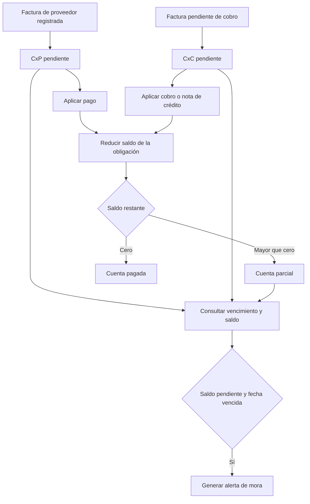

**Relaciones de tablas del flujo:**

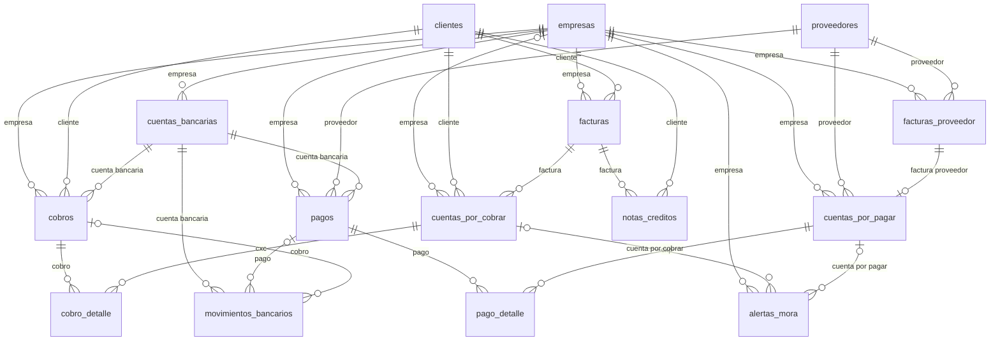

## 10. Proceso completo de pagos

El proceso registra salidas de dinero para liquidar obligaciones con proveedores, desde la captura del pago hasta su conciliación o cancelación.

**Flujo paso a paso:**

1. **Preparar la obligación:** registrar la factura de proveedor para generar su CxP. Para aplicar el pago, la factura debe continuar **Registrada** y la CxP debe tener saldo suficiente.
2. **Crear el pago:** seleccionar proveedor y cuenta bancaria; capturar fecha, método (efectivo, transferencia, tarjeta o cheque), referencias, total y las aplicaciones a CxP. La cuenta y las obligaciones deben corresponder a la empresa del pago. Los detalles se capturan al crear el documento; su edición posterior no está disponible en este flujo.
3. **Guardar o aplicar:** elegir **Borrador** para conservar la captura sin afectar saldos, o **Aplicado** para ejecutarla directamente. Si no se indica estado, el pago se crea como **Aplicado**. Un borrador también puede pasar a aplicado.
4. **Validar las aplicaciones:** debe existir al menos un detalle; cada importe debe ser positivo y no superar el saldo de su CxP. La suma debe coincidir con el total, con tolerancia de un centavo. Si falla una validación, no se completa la aplicación.
5. **Actualizar saldos:** descontar las aplicaciones de las CxP y dejarlas **Parciales** o **Pagadas**. Disminuir el saldo de la cuenta bancaria por el total y generar un movimiento de **Cargo**, inicialmente **Pendiente**, relacionado con el pago.
6. **Conciliar y cerrar:** incorporar el cargo a la conciliación de la cuenta y período. Cuando la diferencia entre el banco y el saldo interno no supere un centavo, cerrar la conciliación y marcar el movimiento **Conciliado**. El pago conserva el estado **Aplicado**; no tiene un estado ni una operación propia de cierre.
7. **Cancelar un pago aplicado:** utilizar la cancelación del pago de origen. Se devuelven los importes a las CxP, se restituye el saldo bancario y se cancela el movimiento. Las obligaciones vuelven a **Pendientes** o **Parciales**, según su saldo. Un pago **Cancelado** no puede editarse y repetir su cancelación no vuelve a afectar saldos.

**Límites del flujo actual:** registrar el pago afecta el saldo interno, sin enviar una transferencia al banco ni comprobar fondos suficientes. Cancelar un pago conciliado no recalcula la conciliación cerrada. La cancelación de un borrador también devuelve importes a las CxP y al banco, aunque no se hubieran descontado; por ello no representa una reversión correcta de saldos. Cambiar importes de un pago ya aplicado tampoco recalcula sus efectos anteriores.

**Tablas, llaves y relaciones:** todas las tablas siguientes se identifican mediante su llave principal `id`. Se incluyen únicamente las llaves que conectan este proceso.

| Papel | Tabla | Llaves de relación |
| --- | --- | --- |
| Principal: documento | `pagos` | `empresa_id` → `empresas.id`; `proveedor_id` → `proveedores.id`; `cuenta_bancaria_id` → `cuentas_bancarias.id` |
| Principal: aplicaciones | `pago_detalle` | `pago_id` → `pagos.id`; `cxp_id` → `cuentas_por_pagar.id` |
| Obligación | `cuentas_por_pagar` | `empresa_id` → `empresas.id`; `proveedor_id` → `proveedores.id`; `factura_proveedor_id` → `facturas_proveedor.id` (una CxP por factura) |
| Documento de origen | `facturas_proveedor` | `empresa_id` → `empresas.id`; `proveedor_id` → `proveedores.id` |
| Cuenta de salida | `cuentas_bancarias` | `empresa_id` → `empresas.id`; `banco_id` → `bancos.id`; `moneda_id` → `monedas.id` |
| Efecto bancario | `movimientos_bancarios` | `cuenta_bancaria_id` → `cuentas_bancarias.id`; `pago_id` → `pagos.id` (opcional) |
| Cierre bancario | `conciliaciones_bancarias` | `cuenta_bancaria_id` → `cuentas_bancarias.id` |
| Partidas del cierre | `conciliacion_detalle` | `conciliacion_id` → `conciliaciones_bancarias.id`; `movimiento_bancario_id` → `movimientos_bancarios.id` |
| Catálogos de apoyo | `empresas`, `proveedores`, `bancos`, `monedas` | Aportan las referencias de empresa, proveedor, banco y moneda |

Un pago reúne varias aplicaciones y una CxP puede recibir aplicaciones de varios pagos. El movimiento conserva la referencia al pago y se incorpora a una conciliación mediante sus detalles.

**Relaciones de tablas del flujo:**

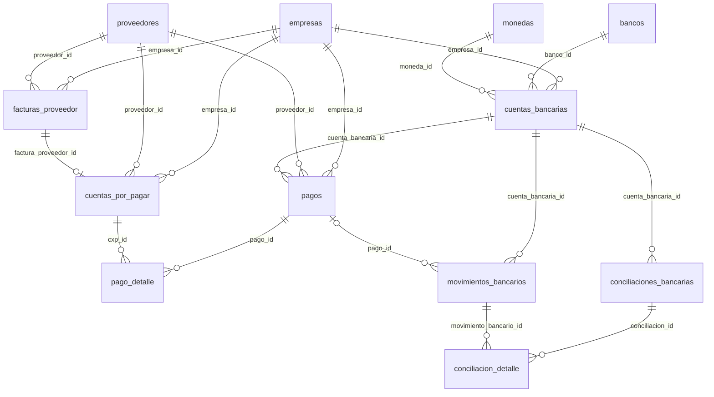

**Dependencias:** CxP aporta la obligación y su factura registrada; bancos y cuentas bancarias registran la salida y permiten conciliarla. CxC no tiene relación directa con `pagos`: los ingresos de clientes se gestionan mediante `cobros` y `cobro_detalle`. Contabilidad puede vincular el pago o su movimiento a `poliza_detalle`, pero aplicar el pago no genera automáticamente una póliza.

